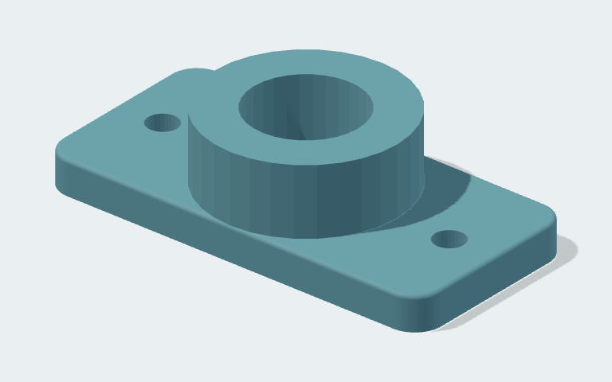
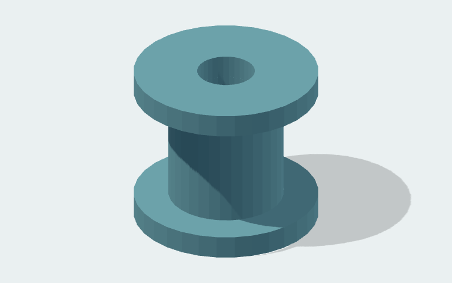
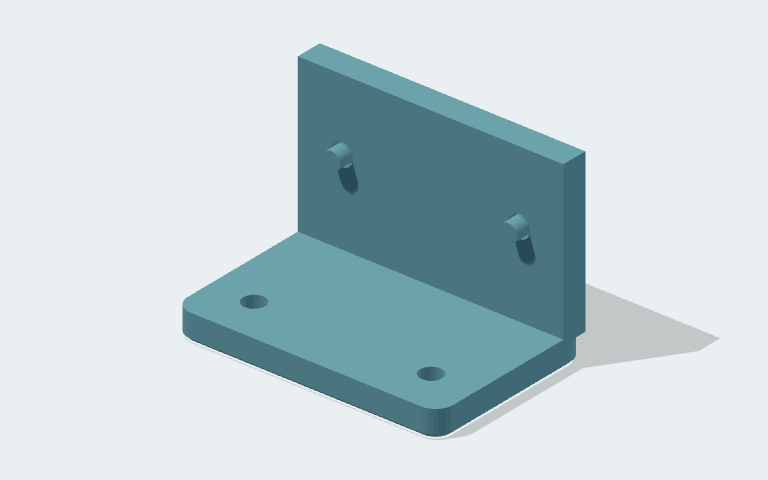
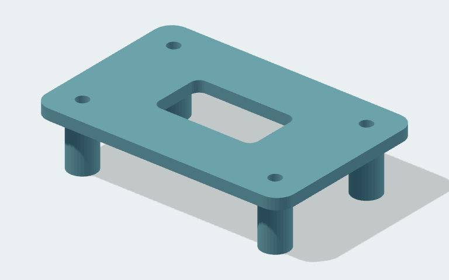
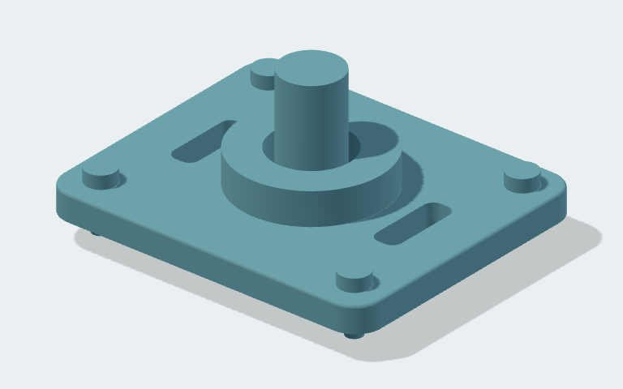
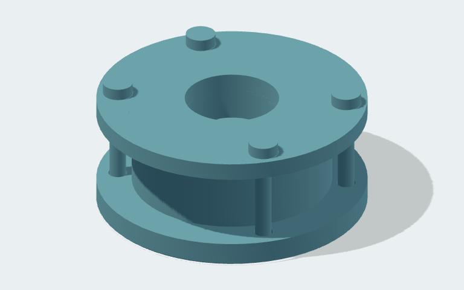
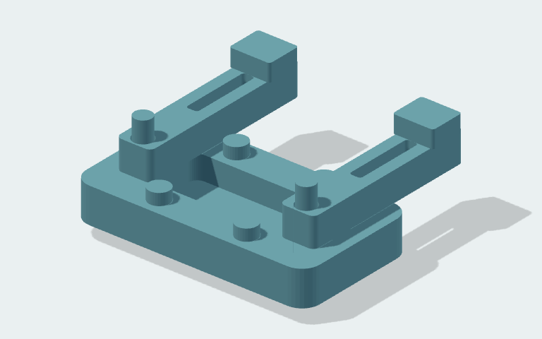
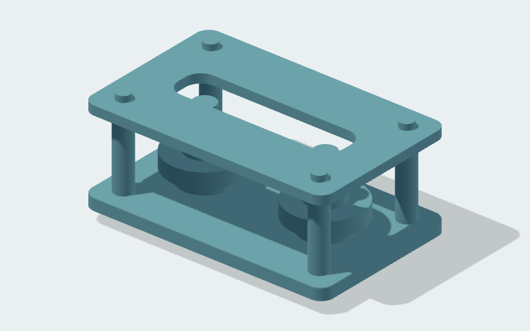
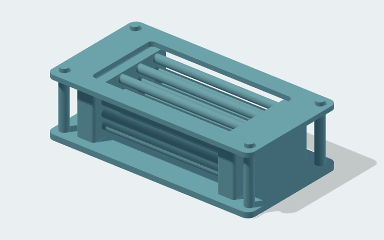
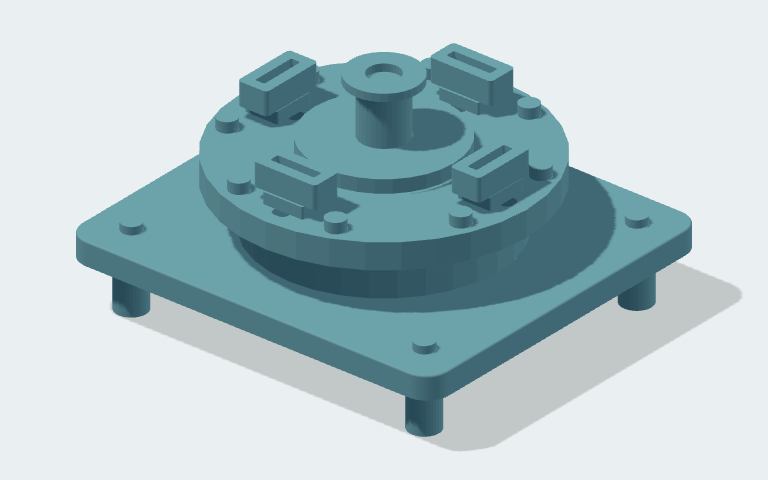

# PlainCAD example projects

The built-in gallery contains 33 editable projects, from a one-part bench stop
to a 40-part rotary fixture. All 33 open with the default PlainSolid kernel,
including the six original projects that needed OpenCascade in an earlier build.
[PlainSolid qualification record](https://github.com/dshills/PlainSolid/blob/f16da30106d323e7ebf7ceba6d09d20c1ef1ed70/docs/evidence/plaincad-gallery-complete-2026-11-17.json)

## Open and explore

1. In Workbench, choose **File → Project gallery** and open a project.
   Filter by **Collection** or **Difficulty**. Search
   also matches the names of suggested parameters. On GitHub, use **Download raw file**
   to download a `.pcaddoc` from this guide.
2. For a downloaded file, choose **File → Open project** or drop it onto the workspace.
3. Open **Project** on the left. Search for a component, then **Activate** or
   **Isolate** it. Use **All tools → Show All Bodies** to restore the entire design.
4. Open **Parameters** to try a suggested parameter edit. For the threaded projects,
   find the suggested feature in **History** and choose **Edit Feature**.
   Undo restores the original.
5. Use **Fit** (or `F`) after opening a dock. On a compact viewport, find **Fit View**
   through **All tools**. Open **History** to inspect sketches and feature steps.
6. **Save** downloads an editable local project. **File → Export STL** opens body
   selection; use **Separate files (ZIP)** for these multi-part examples. The ZIP
   preserves world positions. **File → Download project view PNG** captures the view;
   select a body for an isolated part PNG, or open a sketch for its drawing PNG.

In the original ten designs, parts means modeled component bodies. Each of those
projects has an empty root named
**Project reference**. Components share project coordinates. There are no assembly
joints, motion, placement transforms, nested assemblies, threads, or engineering
load calculations. Clearance and inter-body interference are not qualified.
Some non-mating components deliberately have display clearances. Sketch points are anchored
with fixed constraints for reliable example rebuilds; the named parameter is the
supported starting point for editing each design.

## Gallery

| Project | Parts | Features / sketches | Complexity | Try this parameter edit (mm) |
|---|---:|---:|---|---|
| [Cable guide mount](01-cable-guide.pcaddoc) | 2 | 4 / 3 | Beginner | `foot_thickness`: 5 → 6 |
| [Precision spacer stack](02-spacer-stack.pcaddoc) | 3 | 3 / 3 | Beginner | `spacer_height`: 20 → 24 |
| [Angle bracket fixture](03-angle-fixture.pcaddoc) | 3 | 7 / 6 | Beginner | `web_height`: 36 → 40 |
| [Elevated instrument panel](04-panel-standoffs.pcaddoc) | 5 | 7 / 7 | Intermediate | `post_height`: 18 → 22 |
| [Motor mounting flange](05-motor-flange.pcaddoc) | 6 | 16 / 15 | Intermediate | `flange_thickness`: 8 → 10 |
| [Flanged valve cartridge](06-flanged-valve.pcaddoc) | 8 | 16 / 15 | Intermediate | `valve_height`: 32 → 36 |
| [Parallel robot gripper concept](07-robot-gripper.pcaddoc) | 11 | 22 / 22 | Advanced | `jaw_span`: 56 → 60 |
| [Twin-pulley drive cassette](08-belt-drive.pcaddoc) | 18 | 29 / 28 | Advanced | `pulley_height`: 10 → 12 |
| [Sixteen-tube heat exchanger](09-heat-exchanger.pcaddoc) | 28 | 37 / 37 | Highly complex | `tube_length`: 148 → 152 |
| [Rotary machining fixture concept](10-rotary-fixture.pcaddoc) | 40 | 68 / 66 | Highly complex | `platter_thickness`: 14 → 16 |

Compatibility refers to rebuilding the saved model at its authored dimensions.
The original parameter edit checks used OpenCascade. Other dimensions follow
their own expressions and constraints.

- Spacer washer thickness stays at 4 mm; the angle fixture's holes/pins stay at Z=25 mm.
- The angle fixture's “Web fastener” components represent smooth alignment pins
  without heads or retention. All fasteners are unthreaded teaching representations.
- The gripper has a thin 0.6 mm pocket-to-pivot wall at its default size; it is not
  a manufacturing-ready palm, and smaller jaw spans are not qualified.
- The drive cassette's cover and shaft lengths are fixed; larger pulley-height
  changes can exceed that envelope.
- The rotary platter has 1 mm clearance to the shoulder. Its screw engagement,
  washer/head proportions, support, and retention are illustrative, not qualified.

The covers use native mesh renders with the same orthographic camera, lighting,
framing, and 768 × 480 image size. All covers use the pinned PlainSolid browser worker.

### 1. Cable guide mount

Two-piece rounded foot and annular cable guide with mounting holes.



[Download editable project](01-cable-guide.pcaddoc)

### 2. Precision spacer stack

Three annular parts with a shared bore and parameter-linked upper washer position.



[Download editable project](02-spacer-stack.pcaddoc)

### 3. Angle bracket fixture

An L-shaped joined bracket and two horizontal fasteners; front-plane drilling tests coordinate orientation.



[Download editable project](03-angle-fixture.pcaddoc)

### 4. Elevated instrument panel

A rounded drilled panel over four hollow supports, with a shared post-height parameter.



[Download editable project](04-panel-standoffs.pcaddoc)

### 5. Motor mounting flange

Six parts: a filleted flange with a raised bearing boss, relief slots, shaft and four headed fasteners.



[Download editable project](05-motor-flange.pcaddoc)

### 6. Flanged valve cartridge

Eight parts: bored valve body, cover, plunger, gasket and four bolts, with matched hole patterns.



[Download editable project](06-flanged-valve.pcaddoc)

### 7. Parallel robot gripper concept

Eleven static parts: pocketed palm, slotted jaws, pins, contact pads and four fasteners.



[Download editable project](07-robot-gripper.pcaddoc)

### 8. Twin-pulley drive cassette

Eighteen parts: windowed cover, stepped pulleys, bearings, shafts, spacers, columns and fasteners. Belt geometry and motion are not modeled.



[Download editable project](08-belt-drive.pcaddoc)

### 9. Sixteen-tube heat exchanger

Twenty-eight static parts with side-plane tubes, bored headers, a windowed guard and support hardware.



[Download editable project](09-heat-exchanger.pcaddoc)

### 10. Rotary machining fixture concept

Forty static components, a turned hub, slotted platter, bearing stack, four clamps and extensive fastening hardware. No rotary joint or machining simulation.



[Download editable project](10-rotary-fixture.pcaddoc)

## Original gallery validation and usability findings

The original OpenCascade run recorded per-body BRep validity,
solid count, exact volume, mesh bounds, parameter edit/undo results, save/open
checks, and decoded binary STL measurements. Across the ten projects: **124 native
bodies, 209 features, and 202 sketches**. Every final body is one valid solid with
positive exact volume. Every ZIP has the expected number of uniquely named STLs;
all coordinates are finite, and signed mesh volumes are positive. The largest
observed tessellated-volume difference from BRep was below **0.18%**.
[Original validation results](VALIDATION.json)

The angle fixture independently checks XZ extrusion along negative Y; the heat
exchanger checks sixteen YZ tubes along positive X against their analytical annular
volumes. XY bases start at Z=0. Native rebuilds in this development Chromium run
ranged from approximately 33 ms to 3.5 s, excluding kernel startup. These timings
are observations, not a performance guarantee.

Full separate-file mesh checks validate each body; they **do not** establish
cross-body fit or perform cross-body overlap checks. Save/open equality checks
cover the durable document, not runtime camera/visibility state. The automated
checks exercised real browser workers; the UI walkthrough separately used visible
controls. This is a recorded validation snapshot, not a new continuous test gate. The temporary
authoring/verification scripts are not distributed; per-project SHA-256 hashes
identify stale evidence if a file changes.
No application runtime code changed, so the full release suite was not rerun.

[Read the screenshot-backed workflow audit](WORKFLOW_AUDIT.md) for the manual
sketch-to-solid walkthrough, complex-project navigation, and prioritized UI fixes.
The original ten gallery projects were authored using the existing immutable document
helpers; they were not all drawn by hand through the UI. No AI provider call was
needed to create their geometry.

## Threaded hardware

Open **File → Project gallery** and search by name, or download the editable files.
Each includes a saved **Thread detail** view. Select a thread feature in
**History** and choose **Edit Feature** to explore its settings. The components
are posed apart so you can see the internal and external threads. The profiles
use nominal geometry.

| Project | Native render | Modeled geometry |
|---|---|---|
| [Trapezoidal lead screw and nut](11-trapezoidal-lead-screw.pcaddoc) | [PNG](images/11-trapezoidal-lead-screw.png) | Right-hand, four-start Ø8 mm screw with 2 mm pitch and 8 mm lead |
| [Left-hand Acme lead screw and nut](12-acme-lead-screw.pcaddoc) | [PNG](images/12-acme-lead-screw.png) | Two-start Ø⅜ in screw with 0.08 in pitch and 0.16 in lead |
| [M6 socket screw and tapped collar](13-m6-threaded-pair.pcaddoc) | [PNG](images/13-m6-threaded-pair.png) | M6 × 1 external and internal threads |
| [Quarter-inch UNC screw and tapped block](14-quarter-inch-unc.pcaddoc) | [PNG](images/14-quarter-inch-unc.png) | 1/4-20 UNC external and internal threads |

The PlainSolid production gallery acceptance test loads each screenshot and
rebuilds its project as two valid native solids with the expected volumes.

## New PlainSolid examples

Each example has a named parameter and a suggested edit. The saved model and the
suggested edit were checked in Chromium with the pinned PlainSolid WASM worker.

| Editable project | Collection | Difficulty | Parts | Try changing | Cover |
| --- | --- | --- | ---: | --- | --- |
| [Slotted bench stop](15-bench-stop.pcaddoc) | Fixtures | Beginner | 1 | `stop_height` from 13 to 18 mm | [PNG](images/15-bench-stop.png) |
| [Five-bore drill guide](16-drill-guide.pcaddoc) | Fixtures | Beginner | 1 | `guide_depth` from 18 to 23 mm | [PNG](images/16-drill-guide.png) |
| [Triangular shelf gusset](17-shelf-gusset.pcaddoc) | Fixtures | Beginner | 1 | `gusset_width` from 8 to 12 mm | [PNG](images/17-shelf-gusset.png) |
| [Dual-switch faceplate](18-switch-panel.pcaddoc) | Enclosures | Beginner | 1 | `panel_thickness` from 4 to 6 mm | [PNG](images/18-switch-panel.png) |
| [Four-step setup gauge](19-step-gauge.pcaddoc) | Fixtures | Beginner | 1 | `gauge_width` from 20 to 26 mm | [PNG](images/19-step-gauge.png) |
| [Flanged pulley blank](20-pulley-blank.pcaddoc) | Motion | Intermediate | 1 | `belt_width` from 17 to 22 mm | [PNG](images/20-pulley-blank.png) |
| [Tapered hose reducer](21-hose-reducer.pcaddoc) | Shop tools | Intermediate | 1 | `outlet_length` from 16 to 22 mm | [PNG](images/21-hose-reducer.png) |
| [Cable spool and axle](22-spool-and-axle.pcaddoc) | Motion | Intermediate | 3 | `spool_width` from 22 to 30 mm | [PNG](images/22-spool-and-axle.png) |
| [Louver-slot grille](23-vent-grille.pcaddoc) | Enclosures | Intermediate | 1 | `slot_pitch` from 11 to 12 mm | [PNG](images/23-vent-grille.png) |
| [Vise soft-jaw pair](24-soft-jaws.pcaddoc) | Fixtures | Intermediate | 2 | `jaw_depth` from 14 to 19 mm | [PNG](images/24-soft-jaws.png) |
| [Hex-bit stand](25-bit-stand.pcaddoc) | Shop tools | Intermediate | 2 | `socket_depth` from 12 to 15 mm | [PNG](images/25-bit-stand.png) |
| [Open parts tray](26-parts-tray.pcaddoc) | Shop tools | Beginner | 1 | `wall_thickness` from 3 to 4 mm | [PNG](images/26-parts-tray.png) |
| [Controller enclosure and lid](27-controller-case.pcaddoc) | Enclosures | Intermediate | 2 | `case_wall` from 2.5 to 3.5 mm | [PNG](images/27-controller-case.png) |
| [DIN rail adapter bracket](28-din-mount.pcaddoc) | Fixtures | Intermediate | 1 | `adapter_width` from 26 to 34 mm | [PNG](images/28-din-mount.png) |
| [Open pedal platform](29-pedal-platform.pcaddoc) | Motion | Intermediate | 1 | `platform_depth` from 11 to 15 mm | [PNG](images/29-pedal-platform.png) |
| [Eight-position sample rack](30-lab-rack.pcaddoc) | Shop tools | Advanced | 6 | `rack_clearance` from 28 to 36 mm | [PNG](images/30-lab-rack.png) |
| [Reel stand assembly](31-reel-stand.pcaddoc) | Motion | Advanced | 4 | `stand_width` from 48 to 56 mm | [PNG](images/31-reel-stand.png) |
| [Bench bending die set](32-bending-die.pcaddoc) | Fixtures | Advanced | 3 | `die_length` from 34 to 42 mm | [PNG](images/32-bending-die.png) |

[ORBIT drive housing](orbit-drive-housing.pcaddoc) also opens from the gallery.
Its 16 features include a recessed chamber, bearing bore, and relief slots. Try
changing `bore_diameter` from 40 to 38 mm.
[ORBIT cover](images/orbit-drive-housing.png)

## Regenerate gallery covers

Install the development dependencies, build the pinned PlainSolid WASM assets,
and install Chromium. Start the default server on port 5278.

```sh
npm run dev
```

With the server running, run `node scripts/capture-gallery-covers.mjs`. Pass
one or more example filenames without the `.pcaddoc` suffix to refresh selected
covers, such as `node scripts/capture-gallery-covers.mjs 30-lab-rack`.
The capture checks the solid assertions and kernel source before writing each PNG.
